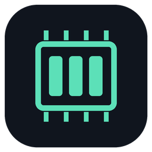
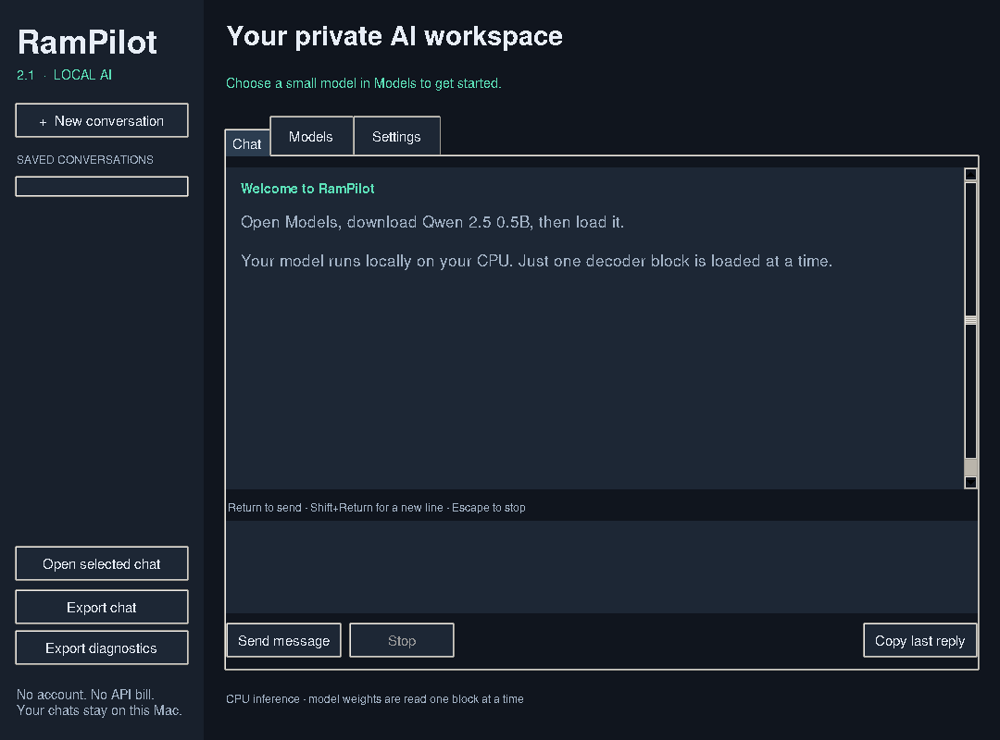
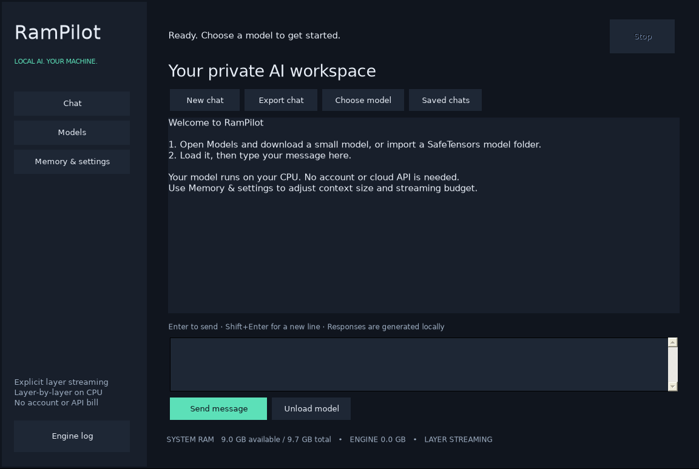

<h1 align="center">RamPilot</h1>

Local AI on your CPU, one decoder block at a time.

RamPilot is an open-source Windows and Intel macOS desktop app for running local
language models with an explicit, bounded weight working set. It reads one
transformer decoder block from disk, computes it on the CPU, releases its weight
tensors, and proceeds to the next. No GPU, API key or separate Python install is
needed by the packaged apps.

**Development release: 2.1.0.** The apps are unsigned. Linux tests, native Windows
Server 2022 installer/CPU checks, and Intel macOS 15 packaging/Tk/NumPy checks
[passed](https://github.com/aamiraria911-a11y/RamPilot/actions/runs/40046458866).
Ventura itself and physical devices still need validation. See
[the test report](TEST-REPORT.md) for exact checks and limitations.

[Download releases](https://github.com/aamiraria911-a11y/RamPilot/releases) ·
[Install and use](PLATFORMS.md) · [Build from source](BUILDING.md) ·
[Report a bug](https://github.com/aamiraria911-a11y/RamPilot/issues)

## Desktop apps

| Platform | Package | Model support |
| --- | --- | --- |
| Windows 10/11, Intel/AMD x64 | `RamPilot-Setup-2.1.0.exe` | Dense Qwen2/Qwen2.5 and standard Llama SafeTensors |
| macOS Ventura 13+, Intel x86_64 | `RamPilot-Mac-Ventura-Intel-2.1.0.zip` | Standard dense Qwen2/Qwen2.5 SafeTensors |

Windows requires .NET Framework 4.8. Setup includes the Python/PyTorch CPU runtime
and checks the Microsoft Visual C++ runtime. Mac includes Intel Python, Tk,
NumPy, regex and TLS certificates. There is no Android app in this release.

1. Install the Windows EXE, or extract the Mac ZIP and move `RamPilot.app` to Applications.
2. Open Models and choose **Qwen 2.5 0.5B** for your first run.
3. Download and verify the model, then Load it.
4. Chat. Return sends, Shift+Return adds a line, and Stop interrupts generation.

Model weights are downloaded separately. The smallest catalog model needs about
0.93 GiB of disk space. An SSD makes a substantial difference. Check the model's
license before use; the 3B catalog model has different terms from 0.5B and 1.5B.

## What is included

- Streaming replies and cancellation, with interrupted prompts retained for retry.
- Saved conversations: searchable sidebar on Mac and Saved chats dialog on Windows.
- Persistent context, RAM budget, reply length, temperature and system instructions.
- Resumable, SHA-256 verified model downloads with pinned repository revisions.
- Download repair that preserves damaged managed files as `.corrupt-*` before replacement.
- Local SafeTensors folder import and explicit unload.
- Live layer/memory information, measured reply speed, and chat export.
- Diagnostics export that excludes chat text, usernames, model paths and session keys.
- Automated inference, state, download and UI tests, plus native build workflows.

## How weight streaming works

For each prompt chunk and generated token, RamPilot reads the embedding rows it
needs, then visits each decoder block in order. Only that block's weight tensors
are materialized. They are released before the next block is loaded, and the
output projection is read in bounded row chunks. The engines assert the live
decoder weight group count stays at zero or one. Ordinary file reads are used;
model weights are not memory-mapped or prefetched a block ahead.

The application still needs RAM for its runtime, tokenizer, active block,
conversion/computation buffers, activations and KV cache. One block and its
workspace must fit. The budget is a planning/allocation check, **not a hard OS
memory limit**. Native allocators and the operating system can retain or cache
released memory. macOS diagnostics report conservative peak process RSS.

This trades memory for storage traffic. Each generated token rereads weights,
so large models can be extremely slow. A short 0.5B test is not evidence of
usable 70B performance. There is no promise that an arbitrary model will fit or
run acceptably on a low-RAM computer.

## Compatibility

The engines support F16, BF16 and F32 SafeTensors weights, converting only the
current tensors to float32 for CPU computation. Sharded checkpoints work when all
shards and tokenizer files are present. No remote Python model code is executed.

Unsupported: GGUF, GPTQ/AWQ and other quantized SafeTensors, MoE, sliding-window
models, custom Mac RoPE scaling, image/audio models, training and arbitrary
architectures. Models made for Ollama usually use GGUF and cannot be imported.

## Privacy and local data

Chat inference stays on your device. There is no telemetry, cloud inference,
agent/tool execution or auto-upload. Hugging Face receives model download
requests. Windows uses an authenticated loopback-only HTTP service internally;
the Mac UI calls its local engine directly.

Chats and settings are plain JSON under `%LOCALAPPDATA%\RamPilot` on Windows and
`~/Library/Application Support/RamPilot2` on Mac. Removing the desktop binaries
preserves these data folders. Disabling chat saving stops future writes and
removes the current compatibility chat file; previously saved archives remain.
Export any conversation you need before manually deleting your data folder.

## Development

The source is MIT-licensed. Bundled dependencies and models keep their own
licenses. See [third-party notices](THIRD-PARTY-NOTICES.txt),
[contribution notes](CONTRIBUTING.md) and [security notes](SECURITY.md).

Windows: C# WinForms / .NET Framework 4.8 UI with a PyTorch CPU streaming service.
Mac: Tk desktop UI with a small NumPy implementation of standard Qwen2 inference.
Both engines are checked against normal Hugging Face float32 reference inference.
